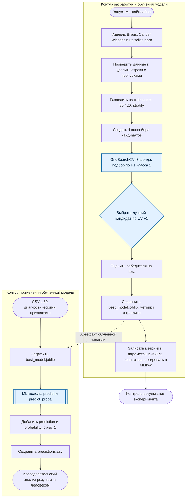

# Model BPMN — место ML-модели в процессе проекта

**Проект:** [automl-project](https://github.com/framey1/automl-project)  
**Задача:** автоматизированное обучение и применение бинарного классификатора опухолей молочной железы.  
**Формат схемы:** Mermaid flowchart с дорожками (логическое представление процесса, а не формальный BPMN 2.0 XML). GitHub отображает Mermaid непосредственно в Markdown.

## 1. Схема процесса

**Обозначения:** выделены этапы обучения, выбора модели и инференса. Пунктирная стрелка показывает передачу сохранённого артефакта из обучения в прогнозирование. Вторая часть — демонстрационный сценарий использования; не подтверждена интеграция в реальную медицинскую информационную систему.

## 2. Какую задачу решает модель

Модель классифицирует наблюдение на **злокачественную опухоль (`0`)** или **доброкачественную опухоль (`1`)** на основе количественных характеристик клеточных ядер. В процессе разработки AutoML-блок выбирает лучший из четырёх алгоритмов по качеству кросс-валидации; при применении сохранённая модель рассчитывает прогноз для новых строк CSV.

Это **вспомогательная учебная система анализа медицинских данных**, а не автономная медицинская диагностика.

## 3. Почему целесообразно использовать ML

Между 30 числовыми характеристиками и классом опухоли могут существовать сложные многомерные зависимости. ML позволяет обучить правило классификации на размеченных наблюдениях вместо ручного задания порогов для всех признаков. Используемый AutoML-блок дополнительно стандартизирует сравнение нескольких алгоритмов и выбор гиперпараметров с кросс-валидацией.

Это обоснование применимости ML в **исследовательской задаче**; оно само по себе не доказывает клиническую полезность или превосходство над врачом.

## 4. Какие данные поступают на вход

**Обучение:** 569 наблюдений Breast Cancer Wisconsin Diagnostic из `sklearn.datasets.load_breast_cancer`, каждое — 30 числовых признаков и размеченный `target`. Исходный набор разбивается в пропорции 80/20 с сохранением баланса классов. В `src/etl.py` выполняются первичные проверки и обработка пропущенных значений.

**Прогнозирование:** CSV с теми же 30 числовыми признаками и совместимой структурой столбцов. Метка `target` при прогнозировании не требуется.

## 5. Как результат используется далее

1. **Во время обучения:** `GridSearchCV` оценивает кандидатов; алгоритм с максимальным средним F1 для класса `1` выбирается как лучший. Его тестовые метрики, графики и сериализованный конвейер используются для проверки и воспроизводимости эксперимента.
2. **При прогнозировании:** `src/predict.py` загружает `models/best_model.joblib`, вычисляет `prediction` и `probability_class_1` и записывает CSV. `probability_class_1` означает оценку вероятности **доброкачественного**, а не злокачественного класса.
3. **После получения результата:** выходной CSV может быть просмотрен и проанализирован в учебном или исследовательском сценарии. Реальная передача результата врачу либо интеграция с клиническим процессом **не реализована и не подтверждена** кодом репозитория.

## 6. Роль подсистем проекта

| Этап | Файл | Назначение |
|---|---|---|
| ETL | `src/etl.py` | Загрузка, проверки, train/test split и сохранение выборок |
| AutoML | `src/automl.py` | Кандидаты, GridSearchCV и выбор победителя |
| Обучение | `src/train.py` | Запуск всех этапов, сохранение модели, метрик и логов |
| Оценка | `src/evaluate.py` | Accuracy, Precision, Recall, F1, ROC-AUC и графики |
| Прогноз | `src/predict.py` | Загрузка сохранённой модели и формирование CSV с предсказаниями |
| Конфигурация | `src/config.py` | Пути, название целевого признака, параметры разделения |
| Автоматизация | `.github/workflows/ci.yml`, `Dockerfile` | Тестирование и воспроизводимый запуск |

## 7. Ограничения и контроль качества

- Основной показатель AutoML — F1 **для доброкачественного класса (`1`)**. Он не гарантирует минимизацию пропусков злокачественных случаев (`0`).
- Качество модели необходимо проверять отдельно по ошибкам классификации злокачественных наблюдений, а не только по общей Accuracy/F1.
- Метрики обучения записываются в JSON и при успешной настройке в MLflow; онлайн-мониторинг качества клинических прогнозов и дрейфа данных в исходном коде не показан.
- До любого применения с реальными пациентами требуются внешняя клиническая валидация, надёжный контроль входных признаков и решение врача.

## 8. Основание схемы

Схема построена по реализации: [README](https://github.com/framey1/automl-project/blob/main/README.md), [ETL](https://github.com/framey1/automl-project/blob/main/src/etl.py), [AutoML](https://github.com/framey1/automl-project/blob/main/src/automl.py), [обучение](https://github.com/framey1/automl-project/blob/main/src/train.py), [оценка](https://github.com/framey1/automl-project/blob/main/src/evaluate.py), [прогнозирование](https://github.com/framey1/automl-project/blob/main/src/predict.py).
