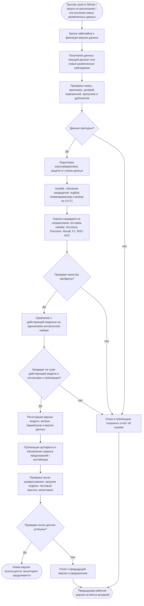

# Процесс автоматического переобучения ML-модели

**Проект:** [automl-project](https://github.com/framey1/automl-project) — классификация опухолей молочной железы по числовым признакам (Breast Cancer Wisconsin Diagnostic).

## 1. Назначение и статус процесса

Схема ниже описывает **предлагаемый целевой процесс** автоматического переобучения и публикации новых версий модели. В проекте уже есть загрузка датасета, подготовка данных, обучение и подбор модели, оценка метрик, сохранение `best_model.joblib`, тесты и запуск обучения в GitHub Actions при `push`. Однако отдельные механизмы получения новых наблюдений, сравнения кандидата с действующей версией, автоматического утверждения, версионирования и продакшен-деплоя **пока не реализованы**. Они показаны как следующие этапы развития проекта, а не как действующая система.

## 2. Схема процесса (Mermaid)

> **Важно:** варианты «по расписанию» и «новые размеченные данные» — предлагаемые триггеры. В текущем `.github/workflows/ci.yml` подтверждён триггер `push`, после которого выполняются тесты и обучение. Схема отражает желаемый процесс до эксплуатационного деплоя.

## 3. Что происходит на каждом этапе

| Этап | Что выполняется | Результат для следующего шага |
| --- | --- | --- |
| 1. Триггер | `push` запускает текущий GitHub Actions workflow. В будущем можно добавить расписание или событие поступления новых размеченных записей. | Задание на запуск с идентификатором коммита/набора данных. |
| 2. Получение данных | Сейчас `src/etl.py` использует датасет Breast Cancer Wisconsin Diagnostic из `scikit-learn`. В целевой схеме возможна загрузка новых данных с известными метками. | Исходная таблица и идентификатор версии данных. |
| 3. Контроль качества данных | Проверка наличия 30 ожидаемых признаков и `target`, типов, меток, пропусков, дубликатов и достаточного числа наблюдений. | Проверенный датасет либо сообщение об ошибке. |
| 4. Подготовка | Очистка и разделение данных с сохранением доли классов. Для будущих переобучений следует закрепить независимый тестовый набор, не используемый при подборе моделей. | Обучающая, валидационная и контрольная выборки. |
| 5. Переобучение | `src/automl.py` сравнивает Logistic Regression, Random Forest, SVC и Gradient Boosting, подбирая параметры с `GridSearchCV`; лучший кандидат выбирается по кросс-валидационному F1. | Обученный кандидат и параметры обучения. |
| 6. Оценка качества | `src/evaluate.py` рассчитывает Accuracy, Precision, Recall, F1-score и ROC-AUC; отдельно анализируются ошибки пропуска злокачественных случаев. | Метрики кандидата и отчёт об ошибках. |
| 7. Решение о публикации | Предлагается пропускать кандидата только при успешных тестах, корректных метриках и отсутствии ухудшения по согласованным критериям относительно действующей модели. Для медицинского сценария требуется экспертное согласование перед реальным применением. | Решение «публиковать» или «отклонить» с причиной. |
| 8. Регистрация версии | Сохранение модели с уникальной версией, её метрик, параметров, версии кода и данных; возможное использование MLflow Model Registry. | Проверяемый и воспроизводимый артефакт модели. |
| 9. Деплой | В целевом процессе контейнер/сервис предсказаний переводится на утверждённую версию; старый артефакт сохраняется для отката. Наличие `Dockerfile` само по себе не означает, что автоматический деплой настроен. | Новая активная версия в среде выполнения. |
| 10. Проверка и мониторинг | Пробный запрос на предсказание, проверка доступности и корректности вывода, затем наблюдение за ошибками и метриками по мере поступления размеченных данных. | Подтверждение эксплуатации либо сигнал на откат. |
| 11. Обработка неуспеха | При плохих данных, неудачных тестах или недостаточном качестве публикация запрещена; при ошибках после деплоя выполняется откат. | Предыдущая рабочая версия остаётся доступной, причина сохраняется в отчёте. |

## 4. Критерии публикации новой версии

**Предлагаемые условия (пороговые значения должны быть утверждены отдельно):**

1. Данные соответствуют схеме, отсутствуют критические ошибки и утечки целевой переменной.
2. Обучение и автоматические тесты завершились успешно.
3. Значения `F1`, `Recall` для злокачественного класса и `ROC-AUC` вычислены на **одном и том же независимом контрольном наборе** для новой и действующей моделей. Нельзя сравнивать несопоставимые разбиения.
4. Новая версия соответствует заранее утверждённым минимальным требованиям и не показывает недопустимого ухудшения по сравнению с действующей моделью. Численные пороги в текущем проекте не заданы, поэтому здесь они не выдумываются.
5. Для использования в реальной медицинской среде дополнительно нужны внешняя валидация, проверка безопасности, экспертное решение и соблюдение применимых требований. Учебная модель не предназначена для самостоятельной постановки диагноза.
6. После деплоя проходят технические smoke-тесты; при сбое происходит откат.

**Если любая проверка не пройдена:** кандидат и отчёт могут быть сохранены для анализа, но действующая версия не заменяется. Если действующей опубликованной версии ещё нет, процесс завершается без деплоя.

## 5. Связь с текущим репозиторием

- [`.github/workflows/ci.yml`](.github/workflows/ci.yml) — фактический триггер `push`, тесты и запуск обучения.
- [`src/etl.py`](src/etl.py) — получение и подготовка текущего датасета.
- [`src/automl.py`](src/automl.py) — подбор модели.
- [`src/train.py`](src/train.py) — запуск обучения, сохранение `models/best_model.joblib`, метрик и мониторинговой записи; попытка логирования в MLflow (при ошибке логирования выполнение продолжается).
- [`src/evaluate.py`](src/evaluate.py) — расчёт метрик и создание графиков.
- [`Dockerfile`](Dockerfile) — контейнеризация локального запуска; автоматическое обновление сервиса после проверки качества требуется добавить отдельно.

Таким образом, для полностью автоматического переобучения до продакшен-деплоя ещё необходимо реализовать источник обновляемых размеченных данных, фиксированный протокол сравнения версий, версионирование артефактов, правило допуска к публикации, механизм развёртывания и отката.
